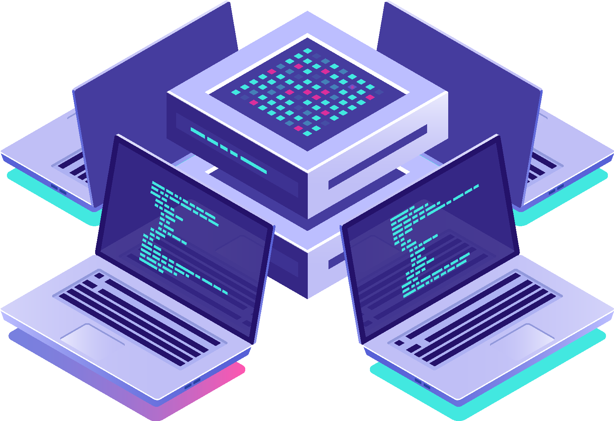

# Emiliano Rivas
### Software Engineer | Backend, Cloud (GCP) & AI / MLOps

Software Engineer with <strong>4+ years of experience</strong> architecting high-availability backend microservices, contract-first APIs, and data-driven web applications serving <strong>28M+ active users</strong>.

Currently focused on cloud-native engineering on <strong>Google Cloud Platform (GCP)</strong>, containerized CI/CD workflows, and bridging <strong>Data Science & Generative AI</strong> (LLMs, RAG, Agentic workflows, and MLOps) with scalable production software.

 

### Connect with me

---

### Production & Engineering Highlights
- **High-Scale Banking Microservices (SNGULAR / BBVA México):** Architected and deployed resilient RESTful services (Java/Spring Boot, RAML contract-first) powering personalized experiences and transactional workflows for **28M+ users** under strict SLA requirements.
- **SaaS & Data Architectures (Interschool):** Engineered full-stack multi-tenant platforms using **Python (FastAPI), TypeScript, Next.js, PostgreSQL, and Neo4j** across 10+ universities.
- **AI, MLOps & Developer Automation:** Building agentic workflows (MCP, RAG, LLM integrations), automated CI/CD quality gates, and data pipelines while pursuing a **B.S. in Data Science Engineering** and the **Google Cloud Generative AI Leader** certification.
- **Security-First Mindset:** Selected among the **Top 7 nationwide** at *Hackmetrix Hackers Academy* and certified in *Secure Software Development (V4.0)*.

---

### Tech Stack

**Languages**  

**Backend & Frontend**  

**Cloud, DevOps & Security**  

**Databases, Data & AI**  

---

### GitHub Activity

  
  

